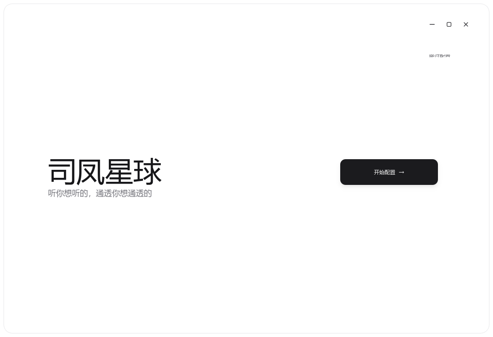
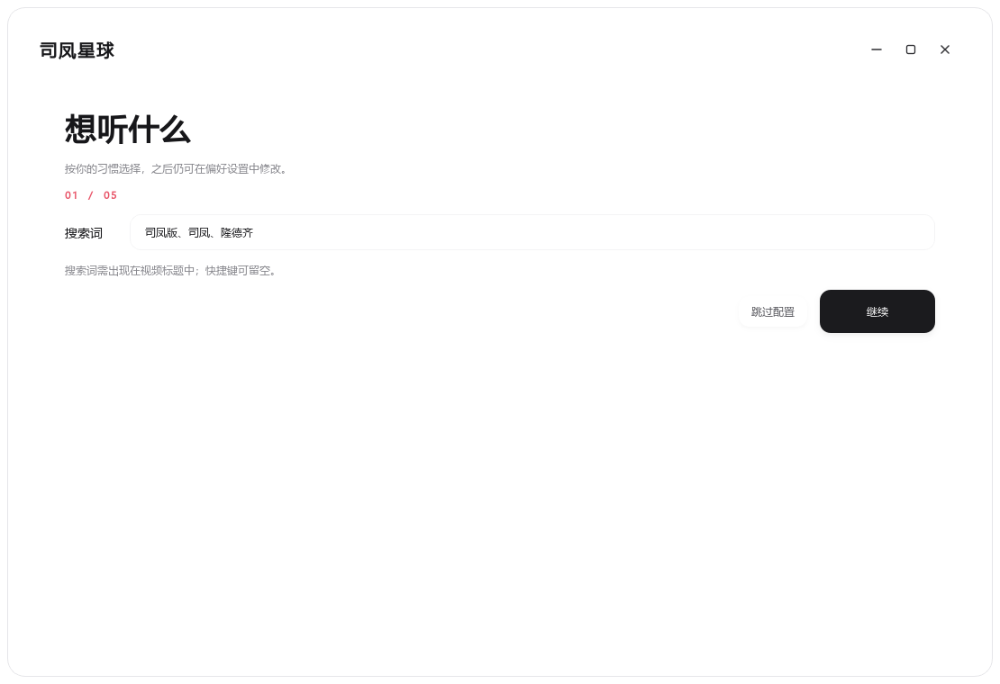
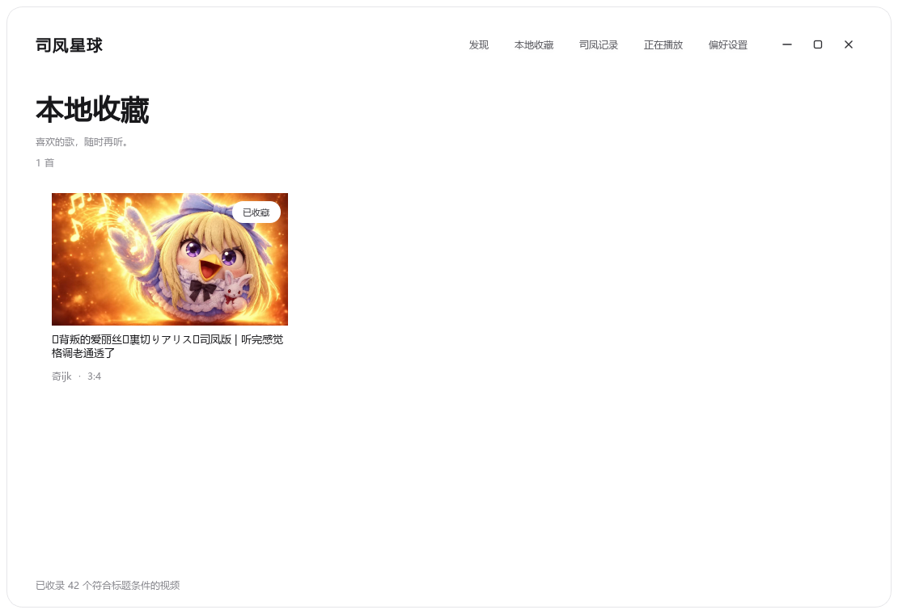

<div align="right"><strong>简体中文</strong> · <a href="./README.en.md">English</a></div>

# 司凤星球

**只听喜欢的。**  从哔哩哔哩发现与「司凤」「司凤版」「隆德齐」有关的声音，在一个安静、轻盈的界面里继续听。

Windows 桌面版 · Android 手机版 · 本地收藏与播放记录


<sub>桌面版 · 发现页。截图中的封面与视频标题属于各自权利人，仅用于界面展示。</sub>

---

## 一眼看见

<table>
  <tr>
    <td width="50%"><br><strong>慢一点开始</strong><br>首次进入后，按自己的习惯逐步配置。</td>
    <td width="50%"><br><strong>听法由你决定</strong><br>搜索词、播放方式、关闭行为与悬浮胶囊，都可以调整。</td>
  </tr>
</table>

<table>
  <tr>
    <td width="50%"><br><strong>喜欢的，留下来</strong><br>本地收藏与「司凤记录」保留听过的歌。</td>
    <td width="50%" valign="top"><br><br><br><br><strong>音乐在，界面退后</strong><br>可选的横向悬浮胶囊显示当前曲目，封面缓慢旋转。</td>
  </tr>
</table>

## 它能做什么

| | |
|:--|:--|
| **发现** | 输入歌名或歌手，组合「司凤」「司凤版」「隆德齐」实时搜索；标题仍须包含指定词。 |
| **播放** | 点开即播放；桌面版边传输边缓存，不必等整首下载完成。 |
| **接着听** | 收藏、历史记录、上一首／下一首，以及顺序、单曲循环或随机播放。 |
| **轻轻收起** | 桌面窗口可收进托盘；推荐卡收起后，仍可从「正在播放」找到音乐。 |
| **手机上听** | Android 原生播放器与窄屏布局；搜索结果按“高播放量 → 随机”轮换。 |

## 获取与运行

到仓库的 **Releases** 页面下载对应文件：

| 平台 | 文件 | 运行方式 |
|:--|:--|:--|
| Windows | `SiFengPlanet.exe` | 双击运行，无命令行窗口。 |
| Android 8.0+ | `sifeng_planet_android.apk` | 安装后打开；悬浮胶囊按需申请系统悬浮窗权限。 |

从源码运行 Windows 版：

```powershell
py -m pip install -r outputs/requirements.txt
py outputs/sifeng_planet.pyw
```

构建 Android 版需要 Android SDK 34 与 Gradle：

```powershell
cd mobile
gradle :app:assembleDebug
```

桌面完整媒体缓存位于 `%LOCALAPPDATA%\SiFengPlanet\Cache`；偏好、收藏与历史位于 `%APPDATA%\SiFengPlanet`。手机端数据保存在本机应用数据中，两个平台暂不互通。使用时需要联网。

## 关于这个项目

这是非官方的个人听歌项目，与哔哩哔哩无隶属关系。搜索结果、封面、视频与音乐来自第三方，权利仍归原权利人；本仓库的许可不覆盖这些内容。

**许可：** 本项目原创代码与自制界面素材采用 [PolyForm Noncommercial 1.0.0](./LICENSE)，允许在其条款范围内进行非商用使用、修改与分发。它**不是 MIT 许可证**，不授予商用许可。许可原文见 [PolyForm Project](https://polyformproject.org/licenses/noncommercial/1.0.0)。
